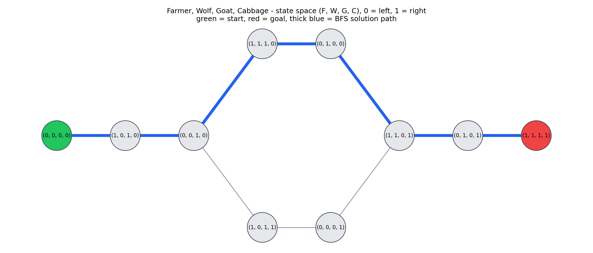

# River Crossing Puzzle Solver using BFS / State Space Search

**AI Course Project Report**

---

## 1. Problem Statement

River crossing puzzles are classic AI problems. A group of characters must cross a
river using a small boat, and some combinations of characters cannot be left alone
together. The task is to find a sequence of crossings that moves everyone safely to
the other side.

This project solves two such puzzles by **state space search**:

1. **Farmer, Wolf, Goat, Cabbage.** A farmer must take a wolf, a goat and a cabbage
   across a river. The boat holds the farmer and at most one item. If the farmer is
   not there, the wolf eats the goat, and the goat eats the cabbage.
2. **Missionaries and Cannibals.** Three missionaries and three cannibals must cross
   using a boat that holds at most two people. On either bank, if there are any
   missionaries, the cannibals must not outnumber them.

The main algorithm is **Breadth-First Search (BFS)**, which finds the solution with
the fewest crossings. **Depth-First Search (DFS)** is also implemented for comparison.

---

## 2. State Representation

A **state** is a snapshot of where everyone is. Each state is stored as a Python tuple,
because tuples can be put in sets and used as dictionary keys (needed for the visited set).

### Farmer, Wolf, Goat, Cabbage

State = `(F, W, G, C)` where each value is `0` (left bank) or `1` (right bank).

| | State |
|---|---|
| Start | `(0, 0, 0, 0)`: everyone on the left |
| Goal | `(1, 1, 1, 1)`: everyone on the right |

There are 2⁴ = 16 possible tuples, but only **10 are valid**.

### Missionaries and Cannibals

State = `(M_left, C_left, boat_side)`

- `M_left`: missionaries on the left bank (0 to 3)
- `C_left`: cannibals on the left bank (0 to 3)
- `boat_side`: `0` if the boat is on the left, `1` if it is on the right

We don't need to store the right bank, because it is always "total minus left".

| | State |
|---|---|
| Start | `(3, 3, 0)` |
| Goal | `(0, 0, 1)` |

**16 states** can be reached from the start.

---

## 3. Operators and Constraints

An **operator** (move) turns one state into another. The `successors(state)` method
tries every operator and keeps only the moves that lead to a **valid** state.

### Farmer puzzle

**Operators:** the farmer always crosses. He can cross:
- alone, or
- with the wolf, the goat or the cabbage, but only if that item is on **his** bank.

So there are at most 4 operators to try from any state. After the validity check,
no state in this puzzle has more than 3 valid moves.

**Constraints** (checked by `is_valid`):
- The wolf and goat cannot be on the same bank without the farmer.
- The goat and cabbage cannot be on the same bank without the farmer.

### Missionaries and Cannibals

**Operators:** move `m` missionaries and `c` cannibals in the boat, where
`1 ≤ m + c ≤ boat_capacity`. With a capacity of 2 there are 5 possible loads:
(1M), (2M), (1C), (2C), (1M+1C). The boat moves from whichever side it is on.
After the validity check, no reachable state has more than 3 valid moves.

**Constraints** (checked by `is_valid`):
- The numbers on each bank must be between 0 and the total.
- On each bank, if missionaries > 0, then cannibals ≤ missionaries.

---

## 4. BFS Pseudocode

BFS explores the state space **level by level**, using a FIFO queue. The `parent`
dictionary remembers how each state was reached, and also works as the visited set.

```
function BFS(problem):
    queue  ← [initial_state]
    parent ← {initial_state: (None, "Start")}      # also the visited set
    expanded ← 0
    generated ← 1                                  # the start state

    while queue is not empty:
        state ← queue.pop_front()

        if is_goal(state):
            return path rebuilt by following parent links back to the start

        expanded ← expanded + 1
        for each (next_state, move) in successors(state):
            generated ← generated + 1
            if next_state not in parent:            # not visited yet
                parent[next_state] ← (state, move)
                queue.push_back(next_state)

    return None                                    # no solution
```

### What the counters mean (exactly as in the code)

- **nodes_generated** = the start state **plus every successor produced**, including
  successors that were already seen.
- **nodes_expanded** = the number of states whose successors were produced.
- Both BFS and DFS **test for the goal when a state is removed** from the queue/stack,
  not when it is first generated. That's why the goal state itself is never counted
  as expanded.

---

## 5. DFS for Comparison

DFS goes **as deep as possible** along one route before backtracking. It uses a LIFO
stack (a Python list) instead of a queue.

```
function DFS(problem):
    stack   ← [(initial_state, [initial_state])]   # state + path to it
    visited ← empty set
    expanded ← 0
    generated ← 1

    while stack is not empty:
        (state, path) ← stack.pop()
        if state in visited: continue
        add state to visited

        if is_goal(state):
            return path

        expanded ← expanded + 1
        for each (next_state, move) in successors(state):
            generated ← generated + 1
            if next_state not in visited:
                stack.push((next_state, path + [next_state]))

    return None
```

The only real differences from BFS are **stack vs queue** and when a state is marked
visited (DFS marks it when it is popped, because a state can be pushed more than once
before it is explored).

---

## 6. Complexity

Let **b** = branching factor (the most moves possible from one state),
**d** = depth of the shallowest solution, and **m** = maximum depth of the search.

| Property | BFS | DFS |
|---|---|---|
| Time | O(bᵈ) | O(bᵐ) |
| Space | O(bᵈ): keeps a whole level in the queue | O(b·m) for the stack alone |
| Complete? | Yes (finite branching factor) | Yes here, because the state space is finite and we keep a visited set |
| Optimal? | **Yes, when every move costs the same (unit cost)** | **No**, it returns the first solution it finds |

In our puzzles every crossing costs 1, so **BFS always returns a shortest solution**.
Here 4 (farmer) or 5 (M&C) operators are tried per state, but only up to 3 of them
are valid, so the real branching factor is b ≤ 3, and d = 7 or 11. Because we keep a visited set, each
state is expanded at most once, so in practice the work is limited by the number of
states (10 and 16), which is tiny.

---

## 7. Implementation Overview

All code is in Python. The search algorithms do not use any search library.

| File | Purpose |
|---|---|
| `solver.py` | `Problem` base class, `bfs()`, `dfs()`, `compare()`, both puzzle classes, `PUZZLES` dict, command-line demo |
| `test_solver.py` | pytest tests: farmer = 7 crossings, M&C = 11 crossings, every state in each path is valid, BFS ≤ DFS, unsolvable case returns `None` |
| `app.py` | Flask web server with `/api/puzzles`, `/api/solve` and `/api/compare` |
| `static/` | Web page (HTML, CSS, vanilla JavaScript) with an animated river scene |
| `visualize.py` | Draws the farmer puzzle state space with networkx and matplotlib |

**Design idea:** `bfs()` and `dfs()` only use four things from a problem:
`initial_state`, `is_goal()`, `successors()` and `to_display()`. So a new puzzle
can be added by writing one new subclass of `Problem`, without changing the search code.

Each search returns a dictionary:

```python
{
    "path": [{"state": ..., "move": ..., "left": [...], "right": [...]}, ...],
    "nodes_expanded": ...,
    "nodes_generated": ...,
    "path_length": ...,     # number of crossings
    "time_ms": ...,
}
```

### State space graph (farmer puzzle)



Green is the start, red is the goal, and the thick blue edges are the BFS solution.
The graph shows that there are **two different 7-move solutions** (the top and bottom
branches). BFS found the top one, and DFS found the bottom one.

---

## 8. Results: BFS vs DFS

These are real numbers from running `python solver.py`.

| Puzzle | Algorithm | Path length | Nodes expanded | Nodes generated | Time (ms)* |
|---|---|---|---|---|---|
| Farmer, Wolf, Goat, Cabbage | BFS | 7 | 9 | 20 | ≈ 0.1 |
| Farmer, Wolf, Goat, Cabbage | DFS | 7 | 9 | 20 | ≈ 0.1 |
| Missionaries & Cannibals (3, 3, 2) | BFS | 11 | 14 | 31 | ≈ 0.1–0.2 |
| Missionaries & Cannibals (3, 3, 2) | DFS | 11 | 11 | 26 | ≈ 0.1 |

\* Times change slightly on every run and depend on the computer. They are all well
under 1 millisecond, so the node counts are a better way to compare the algorithms.

### Discussion

**DFS found a shortest path here only because the state spaces are tiny.** BFS is
*guaranteed* to find a shortest path when every move has the same cost. DFS has no such
guarantee: it returns the first path it reaches, however long. With 10 and 16 states,
there isn't much room for a long detour, so DFS happened to find a 7-move and an
11-move solution. In a bigger state space DFS could easily return a much longer path.

**Farmer puzzle (both expand 9 nodes).** There are 10 states, and both algorithms
expanded every state except the goal. DFS did take a wrong turn: from `(1,1,0,1)` it
first went into `(0,1,0,0)` and then `(1,1,1,0)`, found that all their neighbours had
already been visited, and backtracked. Those 2 extra states plus the 7 non-goal states
on its path make 9.

**Why DFS expanded fewer nodes on Missionaries & Cannibals (11 vs 14).**
- DFS expanded **exactly 11 states**, which are the 11 non-goal states on its own
  solution path. In other words, it **never backtracked**. On this route, every wrong
  move led only to a state that was already visited (often just undoing the last
  crossing), so DFS skipped it and kept going deeper along the right route.
- BFS must expand **every state at depth 0, 1, 2, …, 10** before it can reach the goal
  at depth 11. That includes side branches DFS never touched, such as the other
  first moves. So BFS expanded 14 of the 16 reachable states.
- This is lucky for DFS, not a general rule. A different successor order could send
  DFS down a long wrong branch first.

---

## 9. Screenshots

> Replace these placeholders with your own screenshots (save them in a `screenshots/` folder).

**Figure 1:** Web app: Farmer puzzle solved with BFS
``

**Figure 2:** Web app: Missionaries & Cannibals mid-animation
``

**Figure 3:** Web app: stats card and BFS vs DFS comparison table
``

**Figure 4:** Terminal output of `python solver.py`
``

**Figure 5:** All tests passing (`pytest`)
``

---

## 10. Conclusion

We modelled two river crossing puzzles as state space search problems, by choosing a
state representation, defining the moves (operators), and writing the rules
(constraints) as a validity check. BFS found the shortest solutions: **7 crossings**
for the farmer puzzle and **11 crossings** for Missionaries and Cannibals (3, 3, 2).

DFS found solutions of the same length, but only because these state spaces are very
small. BFS is the right choice when we want the **fewest moves**, because it is optimal
for unit-cost problems. DFS can use less memory and can sometimes be faster (as on M&C),
but it gives no guarantee about solution length.

Because the search code only depends on the `Problem` interface, the same BFS and DFS
can solve any new puzzle that is written as a `Problem` subclass. The web app and the
state space graph make the search easy to see and explain.

---

## 11. Viva Questions and Answers

**1. What is a state space?**
The set of all states the puzzle can be in, connected by the moves between them. It
can be drawn as a graph: states are nodes and moves are edges.

**2. How did you represent a state in the farmer puzzle?**
As a tuple `(F, W, G, C)` where each value is 0 (left bank) or 1 (right bank).
Start is `(0,0,0,0)` and goal is `(1,1,1,1)`.

**3. Why use tuples and not lists for states?**
Tuples are immutable and hashable, so they can be stored in a set or used as
dictionary keys. That is how we check whether a state was already visited.

**4. Why does BFS give the shortest solution?**
It explores all states at depth 1, then depth 2, and so on. So the first time it
reaches the goal, no shorter path can exist. This holds when every move has the
same cost.

**5. What data structures do BFS and DFS use?**
BFS uses a FIFO queue (`collections.deque`). DFS uses a LIFO stack (a Python list).

**6. Why do we need a visited set?**
Without it, the search would go back and forth between the same states forever
(for example, the farmer crossing alone again and again). It also avoids repeated work.

**7. What is the time and space complexity of BFS?**
O(bᵈ) for both, where b is the branching factor and d is the depth of the shallowest
solution. Space is the main weakness of BFS.

**8. Is DFS optimal? Is it complete?**
DFS is not optimal: it returns the first solution it finds, which may be long. With a
visited set on a finite state space, like ours, it is complete.

**9. What is the difference between nodes expanded and nodes generated?**
Expanded is the number of states whose successors we produced. Generated is the start
state plus every successor produced, including repeats. Farmer BFS: 9 expanded, 20 generated.

**10. Why did DFS expand fewer nodes than BFS on Missionaries and Cannibals?**
DFS went straight down a correct route without backtracking, so it expanded only the
11 states on its path. BFS had to expand every state at depths 0 to 10 first, which
came to 14 states. This was luck, not a guarantee.
